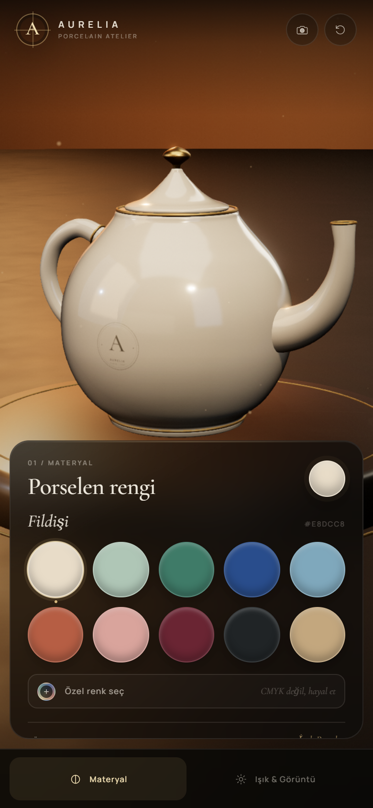

# Aurelia — 3D Porcelain Atelier

**Live demo:** https://cihanserc.github.io/3d-teapot/

An **ultra-realistic, interactive 3D teapot simulator** that runs in the browser.
Built with WebGL + Three.js, it features real-time **PBR (physically based rendering)
lighting**, soft studio shadows, HDR-style environment reflections and cinematic
post-processing.


## Running

- **Online:** Open the live demo link above.
- **Locally:** Download the repo and open `index.html` in a browser (a double-click is enough).
  No internet connection needed — Three.js, fonts and textures are bundled in `dist/`.

## Features

- **Porcelain color** — 10 curated tones plus a custom color picker
- **Surface finish** — Silk Porcelain, Matte Ceramic, Mother-of-Pearl, Satin Metal
- **Scene mood** — Atelier, Golden Hour, Midnight, Gallery
- **Image filters** — Natural, Cinematic, Golden Film, Ice, Noir, Vintage, Dream, Vivid
- **Camera** — Front, 3/4, Close-up and Top views, plus an automatic cinematic orbit
- **PNG snapshot** — save the scene with the camera button in the top-right corner
- **Mobile-friendly** interface



## Controls

| Action | Input |
| --- | --- |
| Rotate | Drag |
| Zoom | Mouse wheel / scroll |
| Color shortcuts | `1`–`9`, `0` |
| Reset | `R` |
| Auto-rotate | `Space` |

## Project structure

```
├── index.html          # app shell and UI
├── dist/
│   ├── app.js          # bundled Three.js scene and logic
│   └── app.css         # styles (fonts embedded)
├── src/                # source modules
│   ├── main.js         # entry point, UI and scene management
│   ├── teapot.js       # teapot model
│   ├── environment.js  # studio environment, lights, floor and plinth
│   ├── post.js         # post-processing and filters
│   ├── textures.js     # procedural textures
│   ├── config.js       # color, finish, mood and camera presets
│   └── styles.css
└── assets/fonts/       # local fonts
```

## Development

```bash
npm install
npm run dev     # build in watch mode
npm run build   # regenerate the dist/ folder
```

## Built with

[Three.js](https://threejs.org/) 0.187 · [esbuild](https://esbuild.github.io/)
