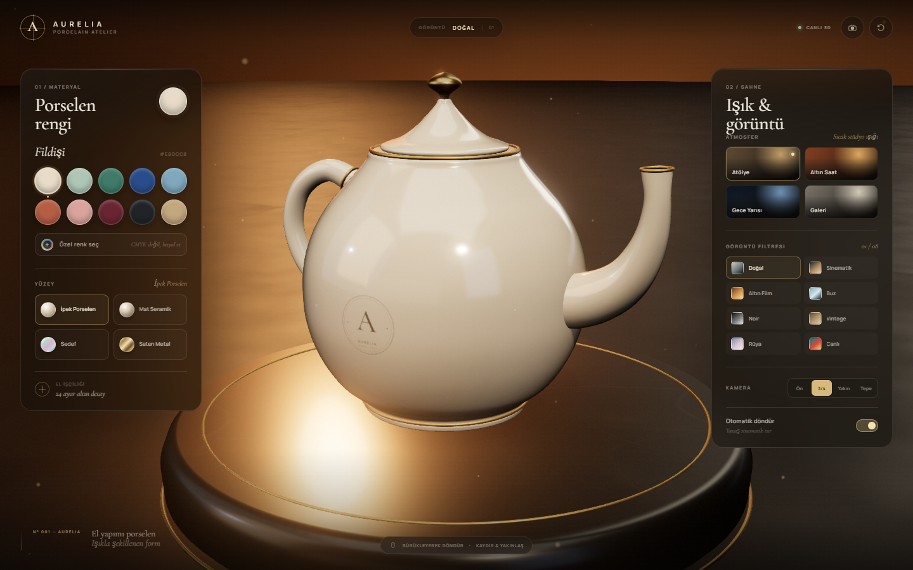

# Aurelia — 3D Porselen Atölyesi

**Canlı demo:** https://cihanserc.github.io/3d-teapot/

Tarayıcıda çalışan, **ultra gerçekçi ve etkileşimli bir çaydanlık (teapot) simülatörü**.
WebGL + Three.js ile gerçek zamanlı **PBR (fiziksel tabanlı) ışıklandırma**,
yumuşak stüdyo gölgeleri, HDR benzeri ortam yansımaları ve sinematik
post-processing içerir.



## Çalıştırma

- **Online:** Yukarıdaki canlı demo bağlantısını açın.
- **Yerel:** Repoyu indirip `index.html` dosyasını tarayıcıda açın (çift tıklamak yeterli).
  İnternet gerekmez; Three.js, yazı tipleri ve dokular `dist/` içinde pakete gömülüdür.

## Özellikler

- **Porselen rengi** — 10 küratörlük ton + özel renk seçici
- **Yüzey dokusu** — İpek Porselen, Mat Seramik, Sedef, Saten Metal
- **Sahne atmosferi** — Atölye, Altın Saat, Gece Yarısı, Galeri
- **Görüntü filtreleri** — Doğal, Sinematik, Altın Film, Buz, Noir, Vintage, Rüya, Canlı
- **Kamera** — Ön, 3/4, Yakın, Tepe açıları ve otomatik sinematik dönüş
- **PNG kare indirme** — sağ üstteki fotoğraf düğmesiyle sahneyi kaydedin
- **Mobil uyumlu** arayüz


## Kontroller

| Eylem | Giriş |
| --- | --- |
| Döndür | Sürükle |
| Yakınlaştır | Tekerlek / kaydırma |
| Renk kısayolları | `1`–`9`, `0` |
| Sıfırla | `R` |
| Otomatik dönüş | `Boşluk` |

## Proje yapısı

```
├── index.html          # uygulama kabuğu ve arayüz
├── dist/
│   ├── app.js          # paketlenmiş Three.js sahnesi ve mantık
│   └── app.css         # stiller (yazı tipleri gömülü)
├── src/                # kaynak modüller
│   ├── main.js         # giriş noktası, arayüz ve sahne yönetimi
│   ├── teapot.js       # çaydanlık modeli
│   ├── environment.js  # stüdyo ortamı, ışıklar, zemin ve kaide
│   ├── post.js         # post-processing ve filtreler
│   ├── textures.js     # prosedürel dokular
│   ├── config.js       # renk, doku, atmosfer ve kamera ön ayarları
│   └── styles.css
└── assets/fonts/       # yerel yazı tipleri
```

## Geliştirme

```bash
npm install
npm run dev     # izleme modunda derleme
npm run build   # dist/ klasörünü yeniden üretir
```

## Teknolojiler

[Three.js](https://threejs.org/) 0.187 · [esbuild](https://esbuild.github.io/)
